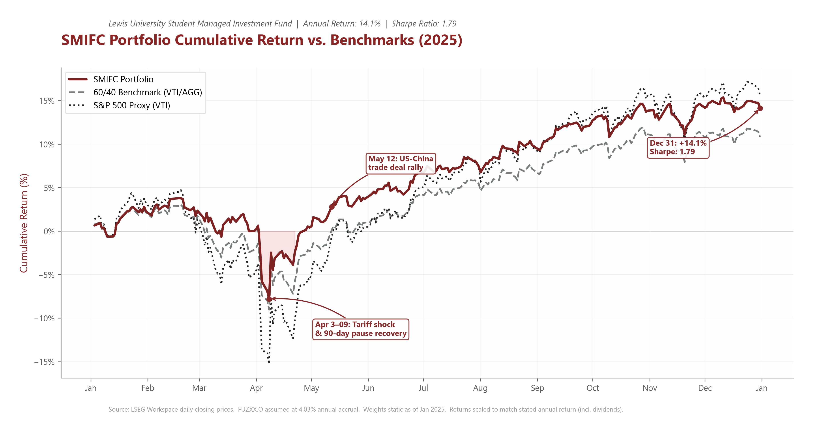

# Lewis University Student Managed Investment Fund: Performance Analysis

Performance analytics and the conference poster for the **Lewis University Student Managed Investment Fund**, a real-money university endowment portfolio. The poster was presented at **SMIFC 2026, Chicago (1 October 2026)**.

[View the poster (PDF)](Lewis_SMIF_SMIFC_2026_Poster.pdf)

| 2025 return | Sharpe ratio (2025) | AUM (Dec 2025) | Growth since 2020 |
|---|---|---|---|
| 14.12% | 1.79 | $468,203 | +88% |

## What's here
- **`notebooks/smifc_performance_chart.ipynb`**: rebuilds the fund's 2025 cumulative return from holding-level daily prices (static allocation weights, with dividend adjustment and a synthetic accrual series for the money-market sleeve) and compares it with a 60/40 benchmark (VTI/AGG) and an S&P 500 proxy (VTI). Key market events are annotated.
- **`notebooks/smifc_growth_trajectory.ipynb`**: the fund's long-run growth path from its 1960s $5,000 endowment to December 2025, using PCHIP interpolation between milestones. Values before 2021 are estimates.
- **`output/`**: publication-quality PNG and PDF charts used on the poster.

**My role:** I built the performance analysis notebooks and charts in this repository.

**Data note:** Daily position prices came from LSEG Workspace and are licensed, so the input file is not redistributed. The notebooks keep their executed outputs.

**Tools:** Python (pandas, NumPy, matplotlib, SciPy).
